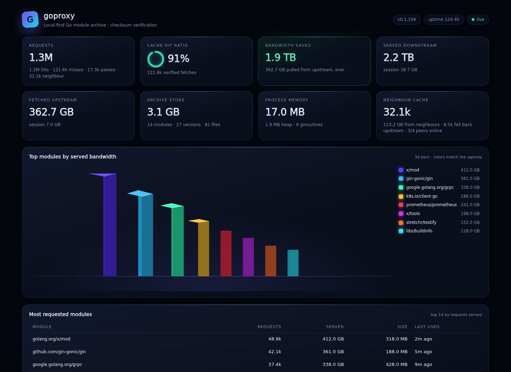
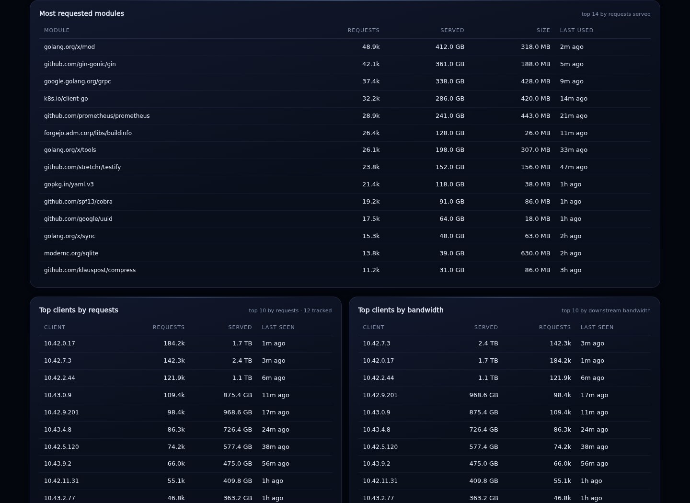
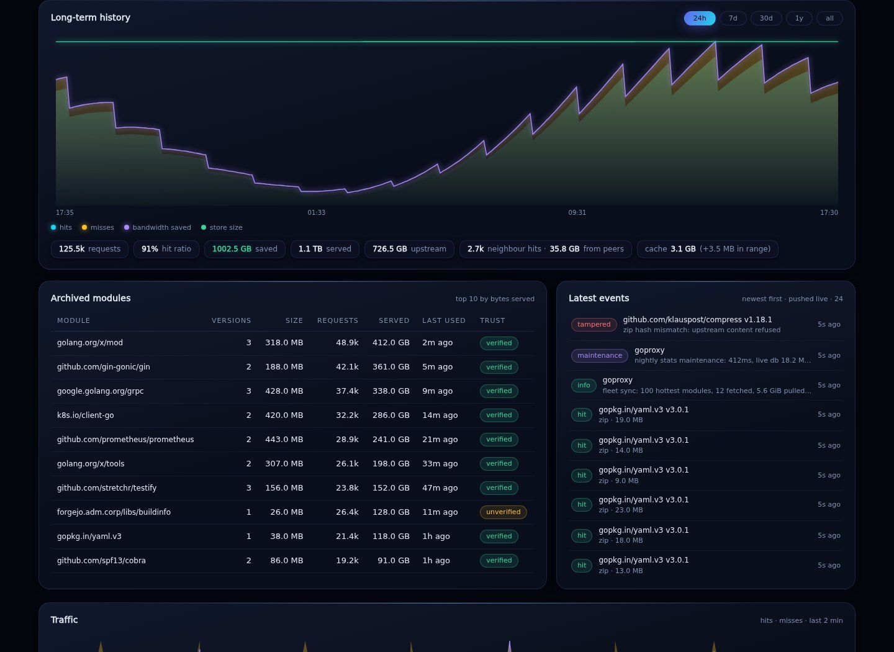
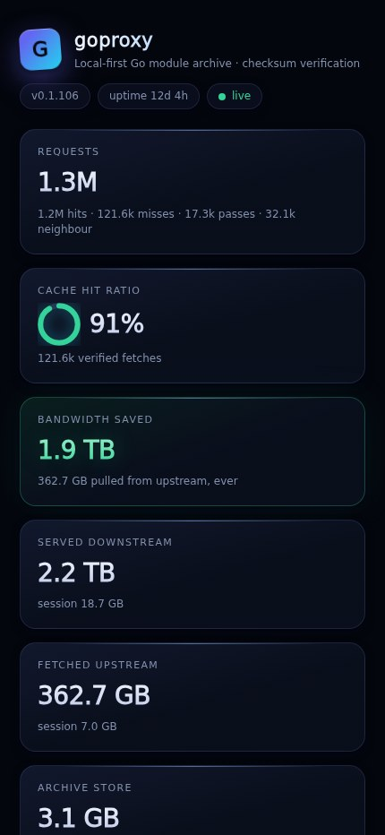
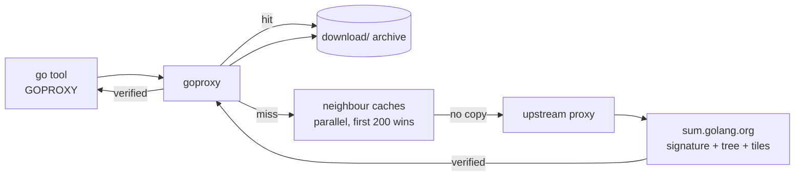

<div align="center">

# goproxy

**Your builds. Your cache. No cloud permission.**

A local-first, checksum-verifying Go module archive that keeps every build fast, reproducible and independent of upstream mood swings.

[](https://go.dev/)
[](https://github.com/paepckehh/goproxy/releases)
[](https://github.com/paepckehh/goproxy/actions/workflows/golang.yml)
[](https://goreportcard.com/report/github.com/paepckehh/goproxy)
[](./LICENSE)


[Quick start](#quick-start) &middot; [Dashboard](#the-dashboard) &middot; [Why goproxy](#why-goproxy) &middot; [Configuration](#configuration) &middot; [Deploy](#deploy)

</div>

<p align="center">
  
  <br>
  <sub>Demo data. The real dashboard is embedded in the binary and pushed live over one SSE stream.</sub>
</p>

---

Point `GOPROXY` at goproxy once. Every module download then flows through a disk-backed archive: hits are served locally, misses are checksum-verified, and the files stay forever. A fleet can chain caches through `NEIGHBOUR_CACHES`, so one warm copy feeds every build machine.

No upstream call on a hit. No rate limit on a hit. No “the cloud is down” on a hit.

## Quick start

```sh
# build (or download a release)
make build

# run: archive at ./cache, dashboard at http://localhost:5100
./goproxy -addr 127.0.0.1:5100 -root ./cache
```

```sh
export GOPROXY=http://127.0.0.1:5100
export GOSUMDB=sum.golang.org   # verification also flows through goproxy
go mod download golang.org/x/mod@v0.42.0
```

Open <http://localhost:5100/> and watch the archive work.

> [!TIP]
> The cache is the archive. Point `-root` at a real disk, back it up, or copy the standard `download/` tree to another machine. Nothing expires.

## The dashboard

One embedded page, zero external assets, one Server-Sent Events stream. No polling, no client-side refresh timer, no CDN. KPIs, top modules, client rankings, neighbour health, pre-cache sync details, long-term history, a live event feed and a rotating 3D bandwidth chart.

| Operations | History |
|:---:|:---:|
|  |  |

<details>
<summary><strong>More dashboard detail</strong> (mobile view and what is measured)</summary>

<p align="center">
  
</p>

- **Lifetime and session** requests, hit ratio, downstream bytes, upstream bytes, bandwidth saved, archive size, process RSS/heap/goroutines, cgroup memory limit.
- **Top modules** by served bandwidth in a 3D chart with a static, readable agenda.
- **The 25 most requested modules** and the **top 10 clients** by requests and by bandwidth; client counters survive restarts in SQLite.
- **Neighbour caches** with online state, version, latency and last check.
- **Pre-cache sync** details: modules considered/fetched/failed, bytes and peer bytes pulled, per-module version/source/result, next run.
- **Long-term history** from 24 hours to all time, minute buckets kept forever, plus the archived-module table and the live event feed.
- **Mobile-friendly** layout down to a single column.

[Full-page view](docs/screenshots/dashboard-full.jpg) · the screenshots are generated from seeded demo data by a unit test:

```sh
make screenshots   # needs Node.js, Playwright and a system Chromium
```

</details>

## Why goproxy

| | |
| --- | --- |
| **Fast by default** | In-memory index, singleflight download dedup, atomic cache commits, `sendfile`-backed serving, negative caching of upstream 404s and parallel peer lookup. |
| **Archive, not a cache** | Files never expire or get evicted. The standard `download/` tree is self-describing, portable, backup-friendly and usable directly as a `file://` proxy source. |
| **Verified, not trusted** | Every `.zip` and `.mod` is checked against the signed sum.golang.org record: note signature, transparency-log tree and tile inclusion proofs. Tampered content gets a `502`, never a cache entry. |
| **Fleet-native** | `NEIGHBOUR_CACHES` asks every peer in parallel before the upstream; the first `200` wins, the rest are cancelled. The hottest requested modules are re-warmed hourly, so the fleet shares one hot set. |
| **Observable to the bone** | Push-only live dashboard, client rankings, peer health, process memory, pre-cache details, and SQLite history that survives reboots. No external JS, no metrics server, no sidecar. |
| **Boring to deploy** | One static, cgo-free binary. systemd socket activation with idle exit, hardened units, a NixOS module, deb/rpm packages and checksummed archives. |
| **Honest failure** | Tampered content is refused, never cached. Checksum-database outages fail closed. Recorder errors show up as warning pills and never degrade proxying. |

### How it works



On a miss, the shared fetch is detached from the requesting client and bounded by a 30-minute timeout. One disconnecting client cannot abort a download that other waiters share; a stalled upstream cannot pin it forever.

<details>
<summary><strong>Verification model and failure behaviour</strong></summary>

On a cache miss, goproxy fetches the signed checksum record for the exact module version through the full `golang.org/x/mod/sumdb` client. The downloaded zip and `go.mod` hashes are compared with the record:

| Case | Result |
| --- | --- |
| Match | Cached, marked verified, signed record kept as provenance |
| Mismatch | Refused with `502`, never cached, surfaced as a `tampered` event |
| No record (private or unpublished module) | Served unverified and clearly marked |
| Record without a hash line for this kind (custom databases) | Served unverified, never refused |
| Checksum database unreachable with `-verify=true` | Fails closed |

The signed tree head is refreshed at startup and every 15 minutes: the note signature is verified, the persisted tree size never rolls back, and the x/mod client is replaced so the next lookup starts from the fresh timeline.

</details>

<details>
<summary><strong>Neighbour fleet and pre-cache sync</strong></summary>

`NEIGHBOUR_CACHES` accepts comma- or whitespace-separated base URLs:

```sh
NEIGHBOUR_CACHES=http://goproxy1:9090,http://goproxy2:9090 ./goproxy
```

Peers are probed through `/healthz` at startup and every 10 minutes. On a miss, all peers are asked in parallel; response headers are bounded to 5 seconds, bodies stream freely, and the first `200` wins. Peer content is verified exactly like upstream content, so a hostile or stale peer cannot inject code. Peer bandwidth is accounted separately from upstream bandwidth.

After the startup index scan, and then once per jittered hour, the proxy resolves the latest version of the 100 most requested modules that have actually served a request and fetches their `.info`, `.mod` and `.zip` through the normal path. One upstream copy serves the whole fleet. Socket-activated `EXIT_ON_IDLE` deployments skip the sync: a process that exits after 30 seconds idle should not crawl 100 modules first.

</details>

## Configuration

Flags win over environment variables.

| Flag | Default | Description |
| --- | --- | --- |
| `-addr` | `:5100` (`BIND_ADDR`) | Listen address; systemd socket activation takes precedence |
| `-root` | `cache` (`CACHE_ROOT`) | Module cache / archive directory |
| `-upstream` | `https://proxy.golang.org` | Upstream module proxy |
| `-sumdb` | `https://sum.golang.org` | Checksum database base URL |
| `-sumdb-key` | official key | Checksum database public key |
| `-verify` | `true` | Verify module hashes against the checksum database |

| Environment | Effect |
| --- | --- |
| `BIND_ADDR` | Listen address when self-binding |
| `CACHE_ROOT` | Module cache directory; put it on a dedicated disk |
| `SOCKET_ACTIVATION=1` | Serve on systemd `LISTEN_FDS`; fall back to `BIND_ADDR` if none were passed |
| `EXIT_ON_IDLE=1` | Exit cleanly after 30 seconds without an in-flight request; socket-activated deployments only |
| `NEIGHBOUR_CACHES` | Parallel neighbour cache base URLs |
| `DEBUG=1` | Per-request access lines and routine upstream/checksum-db failure detail |

<details>
<summary><strong>API reference</strong></summary>

| Route | Behaviour |
| --- | --- |
| `GET /<module>/@v/list` | Forwarded upstream, `no-store` |
| `GET /<module>/@latest` | Forwarded upstream, `no-store` |
| `GET /<module>/@v/<v>.info` | Cached, JSON-validated |
| `GET /<module>/@v/<query>.info` | Branch, short-tag or commit query: forwarded `no-store`, never cached; canonical versions stay on the cached path |
| `GET /<module>/@v/<v>.mod` | Cached, hash-verified |
| `GET /<module>/@v/<v>.zip` | Cached, hash-verified; peers are asked first on a miss |
| `GET /sumdb/<db>/...` | Forwarded verbatim to the configured database only; `/supported` answered locally |
| `GET /` | Embedded push-only dashboard |
| `GET /api/dashboard` | One-shot JSON snapshot for scripts and probes |
| `GET /api/events?range=24h` | SSE: seeded events/store/prewarm/history, live events, counters every 2s, cache state on change, history every 30s, a 25s keepalive tick |
| `GET /api/history?range=24h` | `24h`, `7d`, `30d`, `1y`, `all` |
| `GET /healthz` | Liveness plus version |

</details>

<details>
<summary><strong>Storage and long-term statistics</strong></summary>

```text
<root>/download/<escaped module>/@v/<version>.info|.mod|.zip
<root>/download/<escaped module>/@v/<version>.sum    signed checksum record
<root>/sumdb/                                        verification state + tiles
/var/lib/goproxy/stats.db                            long-term stats (SQLite, WAL)
/var/lib/goproxy/stats.db.backup.daily/              nightly compressed archives
<root>/stats.db                                      only when /var/lib/goproxy
                                                     does not exist
```

The stats database holds lifetime totals, per-module access counters, per-client request/bandwidth rankings, one bucket per minute (kept forever) and the event log (pruned after 90 days). Client rows are pruned after 90 days and capped at the 4096 busiest. The request hot path never touches SQLite: atomics and a buffered channel feed a collector that flushes every 30 seconds plus once on shutdown. Recorder errors surface as warning pills and never degrade proxying. A pre-SQLite `stats.json` snapshot is imported automatically on first start and renamed `stats.json.imported`.

Every night at **23:00 local time** a maintenance window runs without restarting the proxy: semantic check, WAL checkpoint, `VACUUM`/`ANALYZE`/`PRAGMA optimize`, client retention, a verified `VACUUM INTO` snapshot compressed into eight daily generations, and a final empty-WAL checkpoint. A missed window is caught up five minutes after the next start.

The dashboard reads the module index, client ranking, lifetime totals and a one-second memory sample from memory. History series are shared for 20 seconds across open dashboards, so several viewers do not repeat the same SQL aggregation.

</details>

## Deploy

### systemd

The persistent unit is hardened (`ProtectSystem=strict`, seccomp, zero capabilities, `MemoryMax=512M`, bind syscalls pinned to the listen port) and restarts with a bounded 3-starts-per-30s rate limit. The alternative socket-activated fragment passes the listening descriptor via `LISTEN_FDS`, starts on demand and exits cleanly after 30 seconds idle; caddy targets the still-open socket.

### NixOS

```nix
services.go-mod-proxy = {
  enable = true;
  host = "127.0.0.1";          # behind caddy
  port = 7040;
  neighbourCaches = [
    "http://goproxy1:9090"
    "http://goproxy2:9090"
  ];
};
```

`systemd.nix` is the persistent NixOS module; `systemd-socket.nix` is the on-demand socket-activated fragment. Both keep the stats database outside the wipeable cache via `StateDirectory = "goproxy"`, and the persistent unit ships strict filesystem protection, seccomp, zero capabilities, a 512M memory cap and bind syscalls pinned to the listen port.

<details>
<summary><strong>Install from a release</strong></summary>

Grab the archive for your OS/architecture from the [releases page](https://github.com/paepckehh/goproxy/releases), then:

```sh
tar xzf goproxy_*_linux_amd64.tar.gz
sudo install -m 0755 goproxy_*/goproxy /usr/local/bin/goproxy
```

Or use the deb/rpm package from the same release:

```sh
sudo dpkg -i goproxy_*_amd64.deb
```

Or build from source (Go 1.27+):

```sh
git clone https://github.com/paepckehh/goproxy
cd goproxy && make build
```

</details>

## Development

```sh
make build      # versioned binary
make test       # hermetic parallel tests with the race detector
make test-e2e   # real proxy.golang.org + sum.golang.org round trip, opt-in
make check      # gofmt, go vet, go mod tidy -diff
make generate   # go generate ./...
make screenshots # regenerate docs/screenshots (Node.js + Playwright + Chromium)
make release-check    # validate .goreleaser.yml
make release-snapshot # local GoReleaser dry run
```

`-race` needs `CGO_ENABLED=1` for local testing; the shipped binary is `CGO_ENABLED=0`. `make test-e2e` sets `GOPROXY_E2E=1`, fetches `rsc.io/quote@v1.5.2` through the real upstream and checksum database, and exercises the dashboard API/SSE path.

## License

[BSD-3-Clause](./LICENSE)
